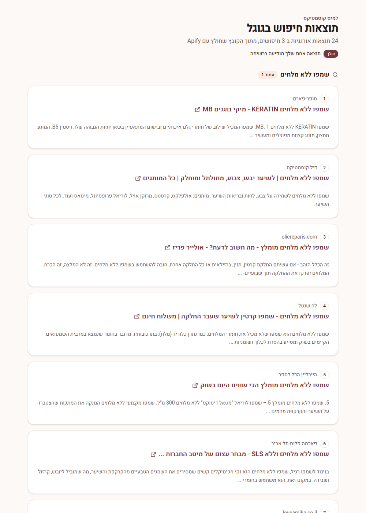

# הדאשבורד של למיס קוסמטיקס

פרויקט Next.js 16 + Tailwind CSS 4 עם shadcn/ui ואייקונים של lucide-react, בעברית ומימין לשמאל.

## הפעלה
```
npm install
npm run dev
```
ואז לפתוח http://localhost:3000

## מה נמצא איפה
- `src/components/product-card.tsx` כרטיס המוצר
- `src/components/ui/` רכיבי shadcn (Button, Card, Badge)
- `src/app/page.tsx` עמוד הדגמה עם שלושה מוצרים לדוגמה
- `src/app/search-results/page.tsx` דף תוצאות חיפוש בגוגל (בכתובת /search-results)
- `src/data/google-search.json` הקובץ מ-Apify שהדף קורא
- `src/app/globals.css` צבעי המותג (משתנים ב-:root, כולל מצב כהה)

## דף תוצאות החיפוש
מציג את התוצאות האורגניות מקובץ Apify (Google Search Scraper): מיקום, שם האתר, כותרת כקישור ותיאור, מקובץ לפי מילת חיפוש. תוצאות של העסק עצמו (lamis_cosmatics) מסומנות בתווית "שלך".
לעדכון הנתונים מחליפים את `src/data/google-search.json` בקובץ חדש מ-Apify.



## שימוש ברכיב
```tsx
import { ProductCard } from "@/components/product-card"

<ProductCard
  product={{
    id: "mask", name: "מסכת קרטין", brand: "Lemis Pro",
    description: "...", price: 89, oldPrice: 110, volume: "500 מ״ל",
    rating: 4.8, reviews: 124, image: "/products/mask.jpg",
    tags: ["שיער צבוע"], label: "מבצע", professional: true,
  }}
  onAddToCart={(product, qty) => console.log(product.name, qty)}
/>
```
שדות רשות: oldPrice, image, tags, label, inStock, professional.
תמונות שמים בתיקייה `public/products/`.

## הוספת רכיבי shadcn נוספים
`npx shadcn@latest add dialog`
